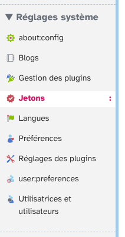
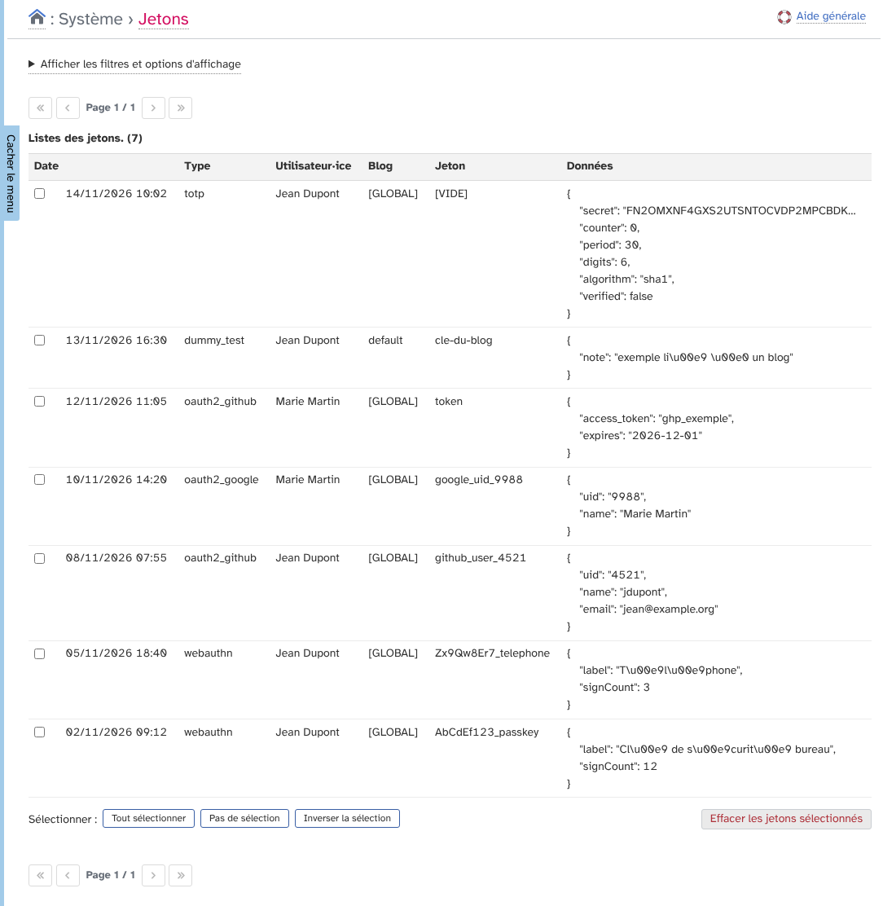
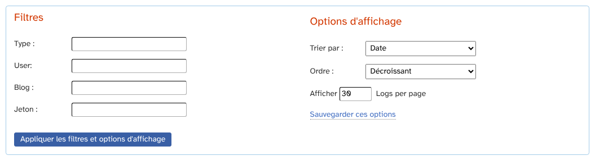
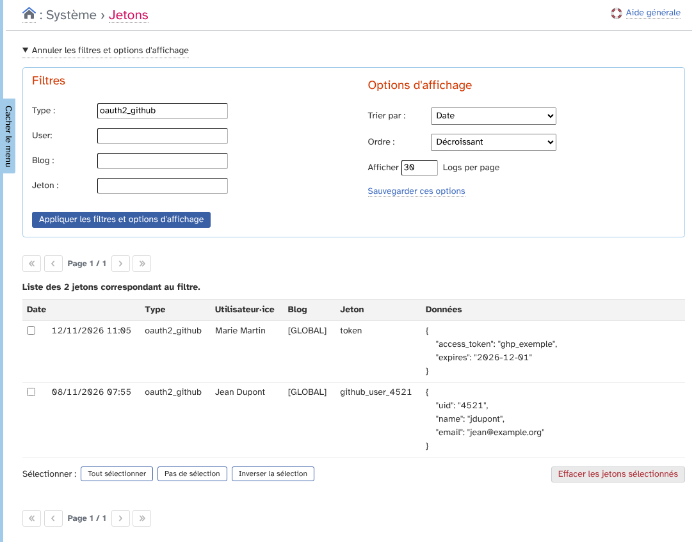
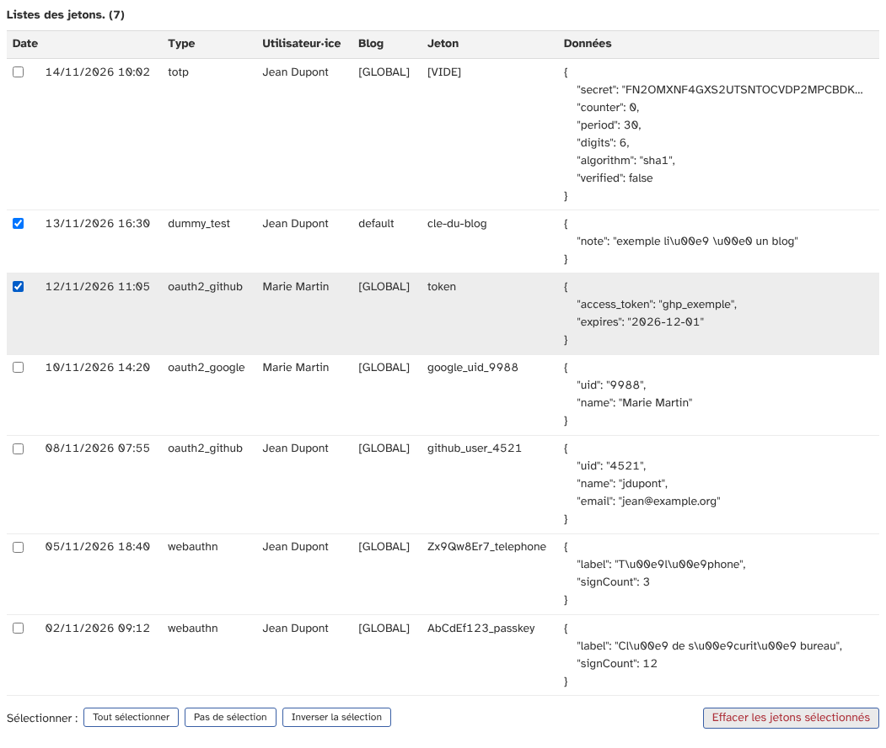
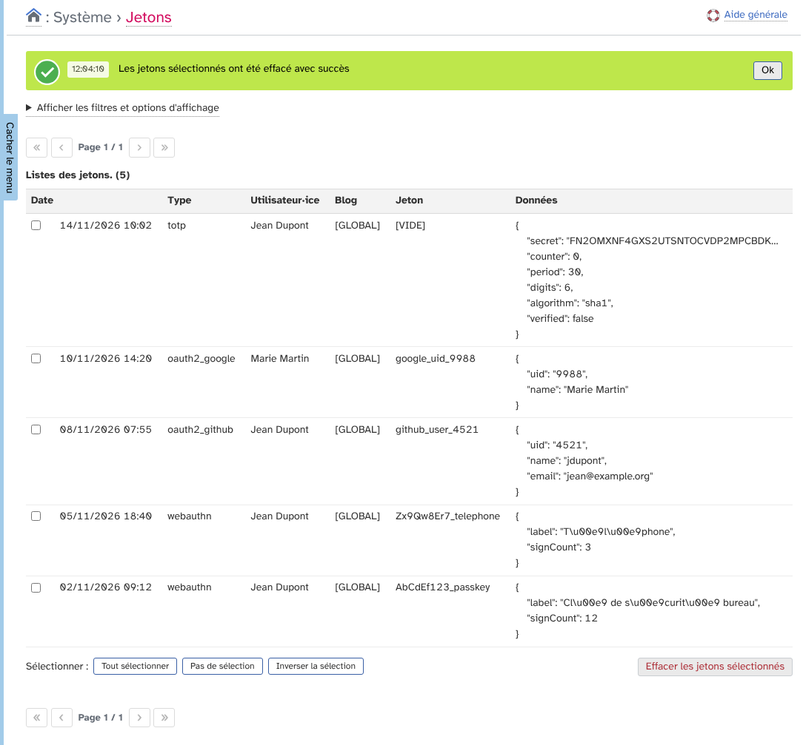
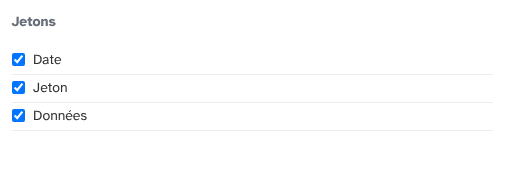
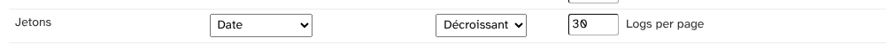

# Jetons (CredentialsRecords) : guide d'utilisation

Ce guide explique comment consulter et nettoyer les jetons (« credentials ») enregistrés par Dotclear avec l'extension CredentialsRecords. Un jeton est un enregistrement de la table des identifiants de Dotclear : clé de sécurité (passkey), compte lié à un service externe (OAuth2), secret de double authentification, etc.

L'extension est réservée aux super administrateurs.

## Sommaire

1. [Ouvrir la liste des jetons](#ouvrir-la-liste-des-jetons)
2. [Lire la liste](#lire-la-liste)
3. [Filtrer et trier](#filtrer-et-trier)
4. [Effacer des jetons](#effacer-des-jetons)
5. [Préférences](#préférences)

## Ouvrir la liste des jetons

Dans le menu **Réglages système**, cliquez sur **Jetons**.

L'extension n'a pas de page de configuration : tout se passe sur cette page.

## Lire la liste

La page affiche tous les jetons, du plus récent au plus ancien, avec le nombre total en haut du tableau.

Chaque ligne a six informations.

* **Date** : la date et l'heure de création du jeton.
* **Type** : la nature du jeton, par exemple `webauthn` (clé de sécurité ou passkey), `oauth2_github` (compte GitHub lié) ou `totp` (code à usage unique de la double authentification).
* **Utilisateur·ice** : la personne à qui appartient le jeton. Passez la souris sur le nom pour voir son identifiant.
* **Blog** : l'identifiant du blog concerné. `[GLOBAL]` indique un jeton qui ne dépend d'aucun blog, ce qui est le cas de la plupart.
* **Jeton** : la valeur qui identifie le jeton pour son type. `[VIDE]` indique qu'il n'y a pas de valeur.
* **Données** : le contenu du jeton, déchiffré et présenté en JSON.

Attention : la colonne **Données** affiche le contenu en clair. Selon le type, cela peut inclure des secrets, comme le secret de double authentification ou un jeton d'accès. Ne partagez pas de capture de cette page sans masquer ces valeurs.

Si aucun jeton n'existe, la page affiche « Il n'y a pas de jetons ».

## Filtrer et trier

Cliquez sur **Afficher les filtres et options d'affichage** pour ouvrir les filtres.

Quatre filtres sont disponibles : **Type**, **User** (l'identifiant de la personne), **Blog** et **Jeton**. Chaque filtre cherche la valeur exacte : `oauth2_github` trouve les comptes GitHub, mais `oauth2` ne trouve rien. Les filtres se combinent.

Les options d'affichage règlent le tri (par date, type, utilisateur·ice, blog ou jeton), son ordre (croissant ou décroissant) et le nombre de jetons par page.

Cliquez sur **Appliquer les filtres et options d'affichage** pour voir le résultat. Le tableau indique alors combien de jetons correspondent au filtre.

Pour garder les options d'affichage pour les prochaines visites, cliquez sur **Sauvegarder ces options**. Pour vider les filtres, cliquez sur **Annuler les filtres et options d'affichage**.

## Effacer des jetons

Pour effacer des jetons :

1. Cochez les lignes à effacer. Les boutons **Tout sélectionner**, **Pas de sélection** et **Inverser la sélection** sous le tableau aident à choisir.
2. Cliquez sur **Effacer les jetons sélectionnés**.
3. Confirmez dans la fenêtre qui s'ouvre.

Une notification confirme l'effacement.

L'effacement est définitif et n'a aucune annulation possible. Les conséquences dépendent du type de jeton.

* Une clé de sécurité (`webauthn`) effacée ne permet plus à la personne de se connecter avec.
* Un compte externe (`oauth2_…`) effacé est délié : la personne devra le lier de nouveau.
* Un secret de double authentification (`totp`) effacé oblige la personne à configurer de nouveau son application.

Le bouton reste grisé tant qu'aucune ligne n'est cochée.

## Préférences

Dans **Préférences**, onglet **Mes options**, un bloc **Jetons** règle l'affichage de la liste pour votre compte.

* **Colonnes** : choisissez de montrer ou de masquer les colonnes **Date**, **Jeton** et **Données**. Les colonnes Type, Utilisateur·ice et Blog sont toujours affichées.

* **Tri** : le tri par défaut, son ordre et le nombre de jetons par page.

Dans l'onglet **Mon tableau de bord**, cochez **Jetons** puis cliquez sur **Ajouter à mes favoris** pour afficher une icône de raccourci sur la page d'accueil.

